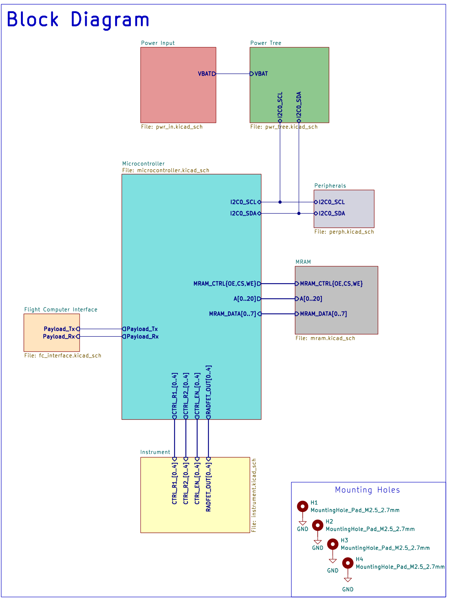
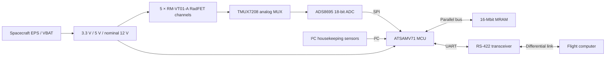
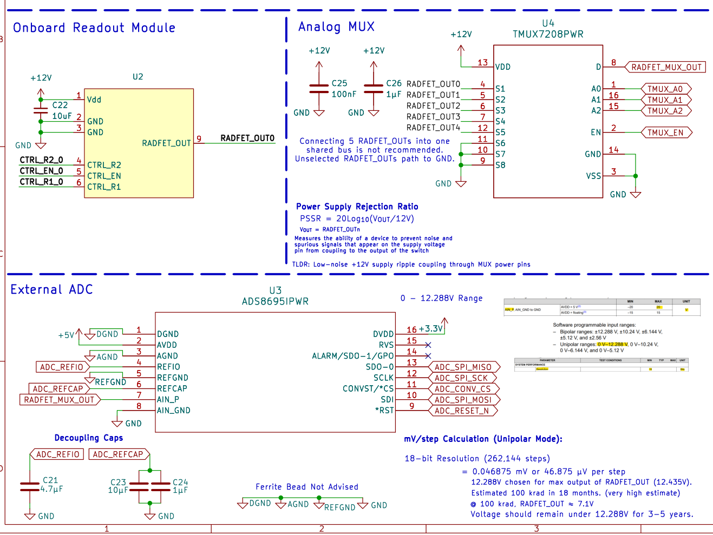
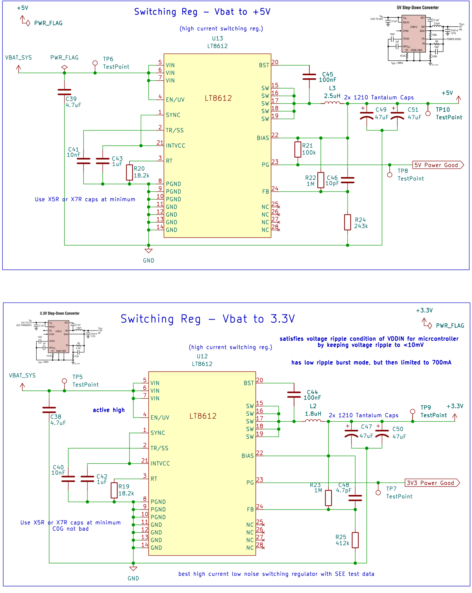

# CADENCE–SWANS Payload Controller

**Radiation payload electronics for a 12U CubeSat**  
*Engineering-model schematic | KiCad 9 | Bronco Space Lab*

The **CADENCE–SWANS Payload Controller** is a custom embedded-electronics design for acquiring, storing, and communicating measurements from radiation-sensitive field-effect transistors (**RadFETs**) aboard a 12U CubeSat. The controller integrates five measurement channels, an external precision ADC, nonvolatile data storage, spacecraft-compatible communications, and a multi-rail power architecture.

This repository presents the **electrical design work** through an eight-sheet KiCad schematic export, with selected circuit excerpts below.

**[View the complete Payload Controller schematic (PDF)](docs/Payload_Controller_EM.pdf)**

## Hardware design at a glance

[](docs/Payload_Controller_EM.pdf#page=1)

*System-level hierarchy from sheet 1 of the engineering-model schematic. Click to inspect the full design package.*

| Design area | Implementation |
| --- | --- |
| **Microcontroller** | Microchip **ATSAMV71Q21B-A**, 3.3 V I/O and internally regulated 1.2 V core |
| **Radiation sensing** | **Five Varadis RM-VT01-A RadFET channels**: one onboard and four external |
| **Analog front end** | **TMUX7208PWR** 8:1 analog multiplexer feeding an **ADS8695IPWR** 18-bit SAR ADC (up to 500 kSPS) |
| **Nonvolatile memory** | **MR4A08BCYS35** parallel-interface MRAM, 16 Mbit (2 MiB) |
| **Spacecraft communications** | MCU UART through an **SN65C1168ERGYR** RS-422 transceiver |
| **Housekeeping** | I²C temperature, inertial, magnetic-field, and input-power monitoring |
| **Power distribution** | 9.0–12.435 V spacecraft input; 3.3 V and 5 V buck rails; nominal 12 V boost rail |
| **Design environment** | **KiCad E.D.A. 9.0.2**, hierarchical schematic across eight sheets |

## System architecture

The microcontroller orchestrates RadFET readout, digitization, local storage, and telemetry:

1. **Acquire:** Five RadFET outputs are routed as separate analog signals to the TMUX7208 multiplexer. Each channel has independent `EN`, `R1`, and `R2` control lines.
2. **Digitize:** The selected analog channel is measured by the 18-bit ADS8695 SAR ADC, with conversion and data transfer controlled over SPI.
3. **Record:** The ATSAMV71 accesses the 16-Mbit MRAM using a parallel address/data interface and dedicated chip-select, output-enable, and write-enable signals.
4. **Monitor:** I²C peripherals report temperature, motion/orientation-related measurements, magnetic field, and spacecraft input voltage/current.
5. **Transmit:** UART telemetry is converted to differential RS-422 signaling for the flight-computer interface.



## Circuit implementation

### RadFET readout and analog acquisition

[](docs/Payload_Controller_EM.pdf#page=3)

*Sheet 3: onboard RadFET interface, five-channel analog selection, and the external 18-bit ADC.*

The analog architecture maintains **individual RadFET outputs** rather than directly combining them into a shared node. The TMUX7208 selects one of the five channels for conversion, while the MCU controls enable and measurement-mode signals. Four external instrument interfaces use **5-pin JST GH connectors** for power/control and separate **Molex 73415-1471 coaxial connectors** for analog readout.

### Spacecraft power and power monitoring

[](docs/Payload_Controller_EM.pdf#page=8)

*Sheet 8: LT8612 buck regulator sections for 5 V and 3.3 V, including power-good monitoring.*

The controller accepts **9.0–12.435 V** from the spacecraft battery management / electrical power system through the **DF51A-4DP-2DSA** input connector. Its power tree uses:

- Two **LT8612** synchronous buck converters for **5 V** and **3.3 V**.
- An **LT1618** boost converter for a **nominal 12 V** analog/instrument supply.
- An **INA219** with a **2 mΩ** shunt to monitor input-side electrical power.
- Separate **5 V** and **3.3 V power-good** signals monitored by the MCU.

The 12 V stage is a **boost-only topology**: when the battery bus rises above the programmed output voltage, it cannot actively step that supply down. The schematic documents this behavior rather than assuming a perfectly regulated 12 V rail over the entire input range.

### Nonvolatile measurement storage

The **MR4A08BCYS35** provides **2 MiB of nonvolatile MRAM**, connected through **21 address lines (`A0–A20`)**, an **8-bit data bus**, and `CS`, `OE`, and `WE` controls. The schematic includes a data-capacity estimate based on **8 bytes per RadFET sample** (32-bit timestamp plus 32-bit ADC value).

At an **illustrative cadence of one five-channel measurement set every 20 seconds**, the raw RadFET records alone would occupy approximately **172.8 kB/day**, or about **12.1 days** of the full 2-MiB memory capacity. This estimate excludes other sensor records, metadata, memory-management overhead, and telemetry offloading.

### Housekeeping and development interfaces

| Device / interface | Function | Address or connection |
| --- | --- | --- |
| **TMP112AIDRLR** | Temperature sensor | I²C `0x48` |
| **LSM6DSOXTR** | Accelerometer / gyroscope | I²C `0x6A` |
| **LIS2MDL** | Magnetometer | I²C `0x1E` |
| **INA219AIDCNR** | Input current / voltage monitoring | I²C `0x40` |
| **SWD / JTAG** | Debug and programming access | MCU debug interface |
| **USB-C** | USB development interface | MCU USB data lines |

*I²C addresses shown are 7-bit addresses from the schematic.*

## Engineering documentation

The [complete eight-sheet engineering-model schematic](docs/Payload_Controller_EM.pdf) provides the electrical implementation, net connections, component references, and design notes. Its sheets are organized as follows:

| Sheet | Subsystem | Source schematic name |
| ---: | --- | --- |
| 1 | Board overview and hierarchical block diagram | `Payload_Controller_EM.kicad_sch` |
| 2 | Microcontroller, clocking, debug and signal mapping | `microcontroller.kicad_sch` |
| 3 | RadFET interfaces, analog mux and ADC | `instrument.kicad_sch` |
| 4 | Differential flight-computer communications | `fc_interface.kicad_sch` |
| 5 | Parallel MRAM interface | `mram.kicad_sch` |
| 6 | Spacecraft battery input connector | `pwr_in.kicad_sch` |
| 7 | I²C sensors | `perph.kicad_sch` |
| 8 | Switching power supplies and monitoring | `pwr_tree.kicad_sch` |

### Repository files

```text
.
├── README.md
├── docs/
│   └── Payload_Controller_EM.pdf
└── assets/
    ├── system-architecture.png
    ├── radfet-analog-readout.png
    └── power-regulation.png
```

The PNGs are **direct visual excerpts of the KiCad-generated PDF**. They are included for convenient preview; the PDF is the authoritative design artifact in this repository. Native KiCad project files are not included in this documentation bundle.

## Project context and attribution

The controller is part of the **CADENCE–SWANS payload** within **Bronco Space Lab**. The schematic title block credits **Angelo Duenas** and **Pragun Bethapudi**. This portfolio documentation focuses on the payload-controller electronics design, including the RadFET measurement path, microcontroller interfaces, MRAM integration, power distribution, and flight-computer communications.

**Design maturity:** This repository documents the **engineering-model schematic**. A schematic export is evidence of circuit design work, not by itself evidence of an assembled PCB, completed electrical validation, environmental qualification, or flight heritage.
